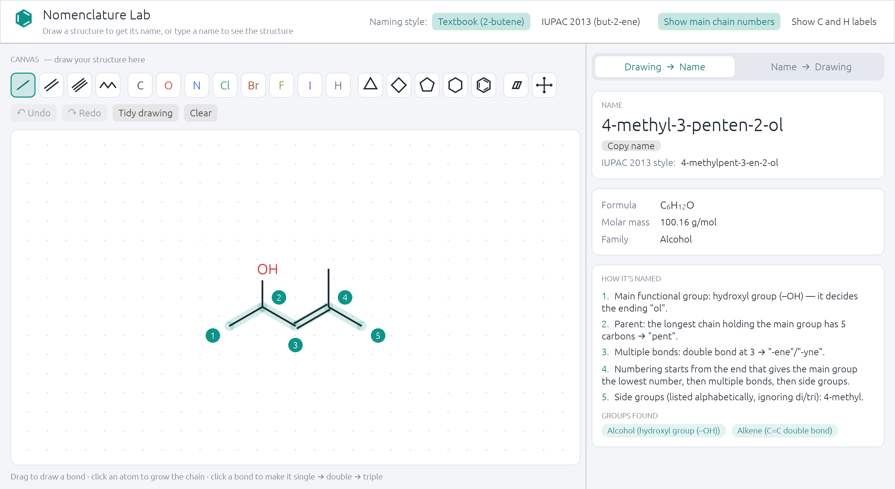
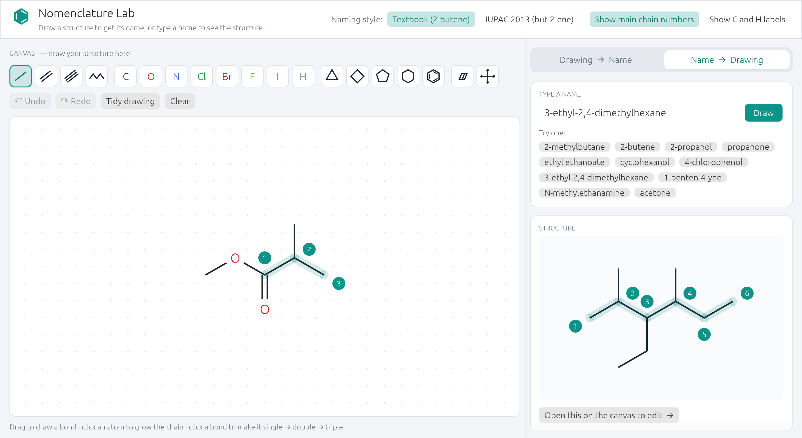

# Nomenclature Lab

A desktop app for learning IUPAC organic nomenclature, written in Rust with [egui](https://github.com/emilk/egui). Draw a structure and get its name with a step-by-step explanation, or type a name and see the structure drawn.



## Features

- **Drawing → Name** – sketch a molecule on the canvas and get its IUPAC name, molecular formula, molar mass, functional-group family and a numbered "how it's named" walkthrough (main group, parent chain, multiple bonds, numbering, substituents).
- **Name → Drawing** – type a name (e.g. `3-ethyl-2,4-dimethylhexane`, `ethyl ethanoate`, `4-chloro-2-methylphenol`) and see the skeletal formula with the main chain numbered. Common names such as `acetone` are accepted. One click moves the result onto the canvas for editing.
- **Two naming styles** – Textbook (`2-butene`, `2-propanol`) or IUPAC 2013 (`but-2-ene`, `propan-2-ol`); the other style's name is shown alongside.
- **Drawing tools** – single/double/triple bonds, zig-zag chains, C/O/N/Cl/Br/F/I/H atoms, 3–6 membered rings and benzene, eraser, move tool, undo/redo, "Tidy drawing", pan (right-drag) and zoom (scroll).



## Supported chemistry

Acyclic and monocyclic carbon skeletons (including benzene) with halogens, alcohols/phenols, ethers, aldehydes, ketones, carboxylic acids, esters, amides, nitriles and amines. Parent-chain selection and numbering follow IUPAC rules. Polycyclic/fused rings, heteroatom rings, stereochemistry and other element types are out of scope.

## Getting started

Requires a recent stable Rust toolchain (edition 2024).

```bash
cargo run --release
```

Run the tests:

```bash
cargo test
```

### Run in the browser (WebAssembly)

The app also compiles to WebAssembly and runs as a static site.

```bash
rustup target add wasm32-unknown-unknown
cargo install --locked trunk   # or: brew install trunk
trunk serve --release          # dev server at http://127.0.0.1:8080
trunk build --release          # static site in dist/
```

On the web, the startup options are read from the URL instead: `?name=acetone`, `?canvas=2-butene`, `&modern`.

Deploy `dist/` to any static host (Vercel, Netlify, Cloudflare Pages, GitHub Pages). The included workflow `.github/workflows/pages.yml` builds and publishes to GitHub Pages on every push to `main` (enable it under Settings → Pages → Source: GitHub Actions). For Vercel, run `trunk build --release` locally or in CI and deploy the `dist/` folder, since Vercel's build image has no Rust toolchain.

### Command-line options

| Flag (desktop only) | Description |
| --- | --- |
| `--name <name>` | Start in Name → Drawing mode with this name |
| `--canvas <name>` | Preload the canvas from an IUPAC name |
| `--modern` | Start with IUPAC 2013 naming style |
| `--screenshot <path.png>` | Render one frame, save it as a PNG and exit |

## Project layout

| File | Purpose |
| --- | --- |
| `src/main.rs` | Entry point, CLI flags, window setup |
| `src/app.rs` | egui UI: canvas, tools, both modes, explanations |
| `src/molecule.rs` | Molecule model (atoms, bonds, valence) |
| `src/namer.rs` | Structure → name (chain/ring selection, numbering, substituents) |
| `src/parser.rs` | Name → structure |
| `src/layout.rs` | 2D coordinate generation for skeletal formulas |
| `src/render.rs` | Skeletal formula painting and theme colours |
| `src/tests.rs` | Naming and round-trip tests |
| `index.html`, `Trunk.toml` | Web build (Trunk) |

## License

[MIT](LICENSE)
